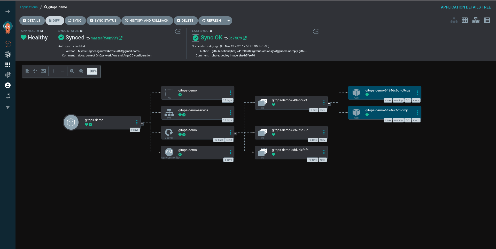
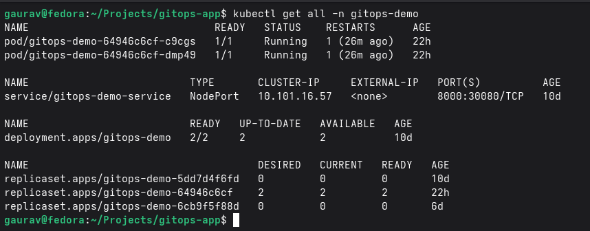
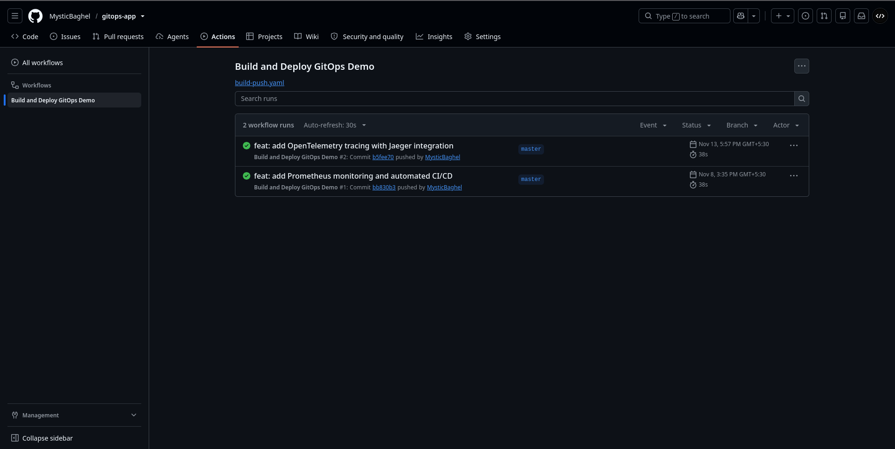
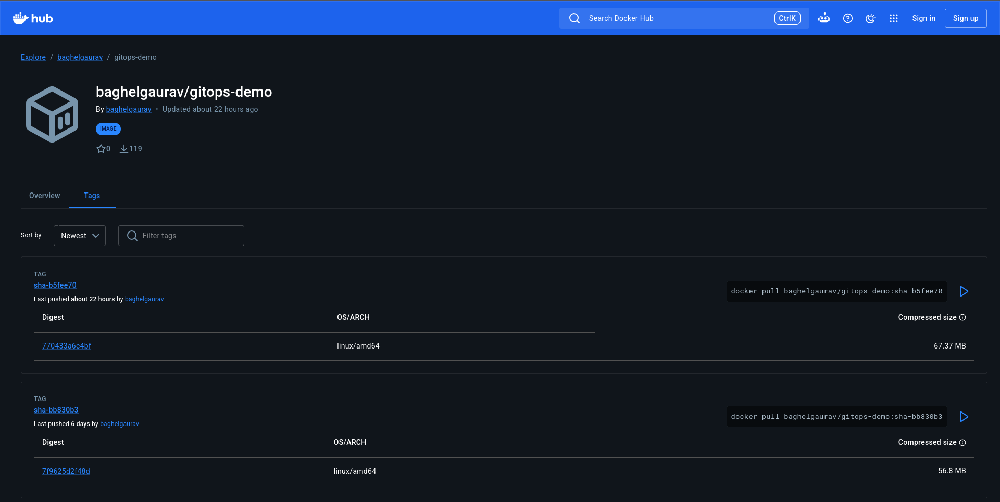
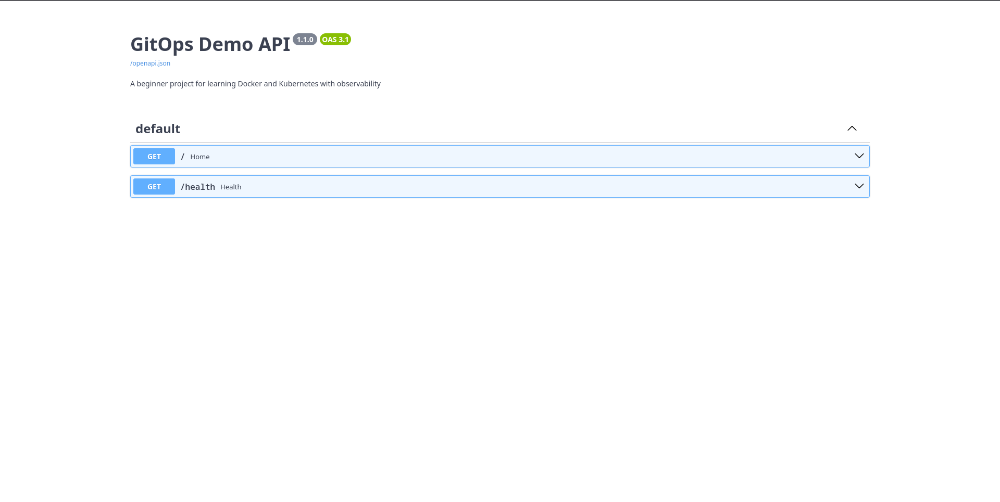

# GitOps Workflow & Observability on Kubernetes

A hands-on implementation of GitOps using Argo CD, Kubernetes, Docker, GitHub Actions, and a complete observability stack.

## Overview

This project demonstrates automated deployment and continuous reconciliation of a containerized FastAPI application on a local Kubernetes cluster.

Argo CD monitors Kubernetes manifests stored in GitHub and synchronizes the cluster with the desired configuration. GitHub Actions automates Docker image builds and pushes updated image tags to the Kubernetes deployment manifest.

The project also implements an observability stack to monitor application performance, collect application logs, and introduce distributed tracing.

## Technology Stack

| Category | Technologies |
|---|---|
| Application | Python, FastAPI |
| Containerization | Docker |
| Container Registry | Docker Hub |
| CI/CD | GitHub Actions |
| Orchestration | Kubernetes, Minikube |
| GitOps | Argo CD |
| Metrics | Prometheus |
| Visualization | Grafana |
| Log Collection | Grafana Alloy |
| Log Aggregation | Loki |
| Distributed Tracing | OpenTelemetry, Jaeger |
| Version Control | Git, GitHub |
| Package Management | Helm |

## Architecture

```text
                    Developer
                        |
                        v
                 GitHub Repository
                        |
             +----------+-----------+
             |                      |
             v                      v
       GitHub Actions             Argo CD
             |                      |
             v                      v
         Docker Hub           Kubernetes Cluster
                                    |
                                    v
                             FastAPI Deployment
                                    |
                              FastAPI Pods
                                    |
                 +------------------+------------------+
                 |                  |                  |
                 v                  v                  v
             Metrics              Logs               Traces
                 |                  |                  |
                 v                  v                  v
             Prometheus           Alloy           OpenTelemetry
                 |                  |                  |
                 |                  v                  v
                 |                Loki              Jaeger
                 |                  |                  |
                 +------------------+------------------+
                                    |
                                    v
                                  Grafana
```

## Key Features

### GitOps and Deployment
- Containerized FastAPI application.
- Kubernetes Deployment and Service.
- Declarative infrastructure configuration.
- Automated synchronization from Git using Argo CD.
- Self-healing and drift correction.
- Resource pruning.
- Automated Docker image builds and pushes using GitHub Actions.
- Automatic image tag updates in Kubernetes manifests.

### Monitoring and Observability

**Metrics — Prometheus and Grafana**
- Application metrics exposed through `/metrics`.
- Kubernetes metrics collection.
- Grafana dashboards for application monitoring.
- HTTP request rate, error rate, availability, and pod health monitoring.
- Prometheus alerting rules.

**Centralized Logging — Loki and Alloy**
- Kubernetes pod log discovery.
- Automated log collection using Grafana Alloy.
- Centralized log storage using Loki.
- Log exploration through Grafana.
- LogQL queries for filtering and analyzing application logs.

**Distributed Tracing — OpenTelemetry and Jaeger**
- FastAPI instrumentation using OpenTelemetry.
- OTLP trace collection.
- Jaeger trace visualization and inspection.
- Request-level tracing to investigate application latency and errors.

## Screenshots

The `screenshots/` directory contains evidence captured from the running environment.

### Argo CD Application — Synced and Healthy

The Argo CD Application view shows the `gitops-demo` Application as `Synced` and `Healthy`, with the Deployment, Service, and Pods reconciled from Git.



### Kubernetes Resources

`kubectl get all -n gitops-demo` shows two running Pods, the NodePort Service on port `30080`, and a Deployment with two available replicas.



### GitHub Actions CI Pipeline

The **Build and Deploy GitOps Demo** workflow completes successfully and publishes a new image tag for each application change.



### Docker Hub Images

Each GitHub Actions run pushes an immutable `sha-<commit>` tagged image to Docker Hub.



### Running Application

The deployed FastAPI application serves its interactive OpenAPI documentation with the `/` and `/health` endpoints.



## Repository Structure

| Directory / File | Purpose |
|---|---|
| `.github/workflows/` | CI/CD automation using GitHub Actions |
| `argocd/` | Argo CD Application configuration |
| `k8s/` | Kubernetes manifests |
| `docs/` | Technical documentation |
| `screenshots/` | Captured evidence of the running deployment and pipeline |
| `main.py` | FastAPI application |
| `requirements.txt` | Python dependencies |
| `Dockerfile` | Application container configuration |

## Observability Components

| Component | Responsibility |
|---|---|
| Prometheus | Metrics collection and alerting |
| Grafana | Dashboards and visualization |
| Loki | Centralized log storage |
| Grafana Alloy | Kubernetes log collection and forwarding |
| OpenTelemetry | Application instrumentation and trace export |
| Jaeger | Distributed trace storage and visualization |

## Documentation

1. [Architecture](docs/01-architecture.md)
2. [Application and Docker](docs/02-application-and-docker.md)
3. [Kubernetes Deployment](docs/03-kubernetes-deployment.md)
4. [Argo CD Setup](docs/04-argocd-setup.md)
5. [GitOps Workflow](docs/05-gitops-workflow.md)
6. [Testing and Validation](docs/06-testing-and-validation.md)
7. [Troubleshooting](docs/07-troubleshooting.md)

Additional observability documentation is maintained in the observability project repository.

## Getting Started

Clone the repository:

```bash
git clone https://github.com/MysticBaghel/gitops-app.git
cd gitops-app
```

Build the application image locally:

```bash
docker build -t gitops-demo .
```

Run the application:

```bash
docker run -p 8000:8000 gitops-demo
```

Access the application:

- Application: `http://localhost:8000`
- Health endpoint: `http://localhost:8000/health`
- Prometheus metrics: `http://localhost:8000/metrics`

See the [documentation](docs/) for Kubernetes deployment, Argo CD configuration, and GitOps workflow instructions.

## Author

**Gaurav Singh Baghel**

[GitHub Profile](https://github.com/MysticBaghel)
