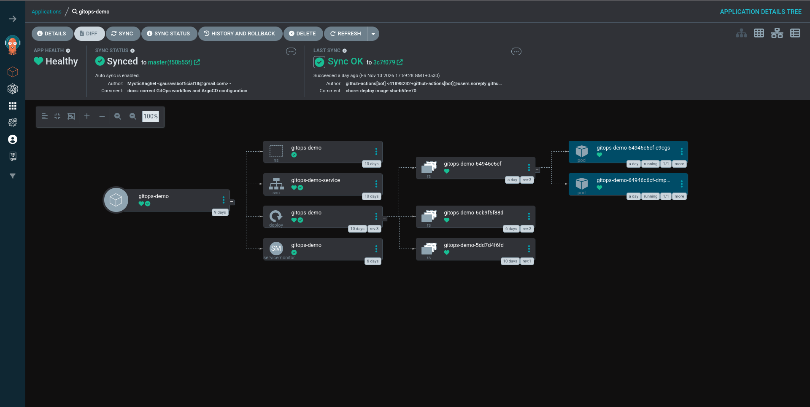

# System Architecture

## Overview

The project implements a GitOps workflow in which GitHub acts as the source of truth for Kubernetes application configuration.

Argo CD monitors the repository and reconciles the Kubernetes cluster with the desired state defined in Git.

## Architecture Diagram

```text
                 Developer
                     |
                     v
              GitHub Repository
                     |
                     v
                  Argo CD
                     |
              Reconciliation
                     |
                     v
             Kubernetes Cluster
                  Minikube
                     |
               Deployment
                     |
                ReplicaSet
                     |
                 FastAPI
                   Pods
                     |
                  Service
                     |
                  Browser
```

## Component Responsibilities

| Component | Responsibility |
|---|---|
| FastAPI | Provides application endpoints |
| Docker | Packages the application |
| Docker Hub | Stores container images |
| Kubernetes | Orchestrates application containers |
| Minikube | Provides a local Kubernetes cluster |
| kubectl | Interacts with Kubernetes resources |
| GitHub | Stores application and infrastructure configuration |
| Argo CD | Synchronizes Git configuration with Kubernetes |

## GitOps Reconciliation

The repository defines the desired state of the application.

Argo CD compares this desired state with the live Kubernetes resources and attempts to reconcile differences.

When reconciliation succeeds, the Application reports `Synced` and `Healthy`, and the detail tree shows the Namespace, Service, Deployment, ServiceMonitor, ReplicaSets, and Pods managed by the Application.



## Resource Organization

- `gitops-demo` namespace: Application workloads.
- `argocd` namespace: Argo CD components.
- `k8s/`: Kubernetes manifests.
- `argocd/`: Declarative Argo CD Application configuration.
