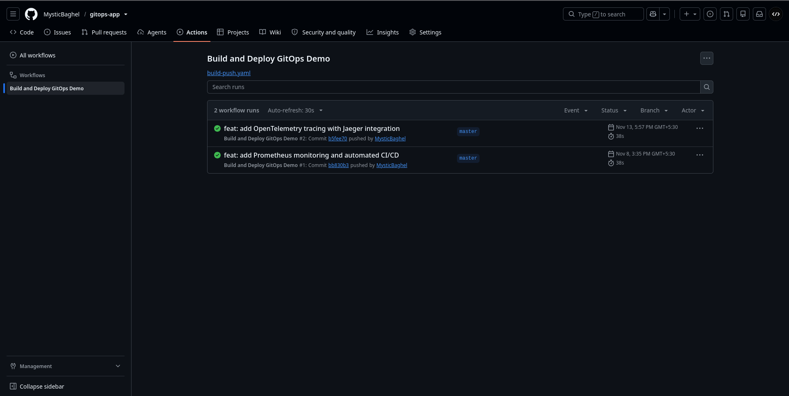
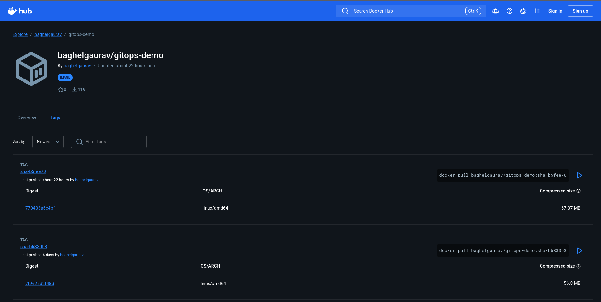

# GitOps Workflow

## Overview

GitOps uses Git as the source of truth for the desired Kubernetes configuration. Argo CD monitors the configured repository and reconciles the Kubernetes cluster with the manifests in that repository.

This project uses two connected automation steps:

1. GitHub Actions builds the FastAPI container image, pushes it to Docker Hub, and updates the image tag in `k8s/deployment.yaml`.
2. Argo CD detects the manifest change and synchronizes the Kubernetes Deployment to use the image tag recorded in Git.

## Repository Configuration

| Parameter | Value |
|---|---|
| Repository | `https://github.com/MysticBaghel/gitops-app.git` |
| Branch | `master` |
| Manifest path | `k8s/` |
| Argo CD Application | `gitops-demo` |
| Destination namespace | `gitops-demo` |

The Application manifest is stored at `argocd/application.yaml`. Apply it from the repository root when creating or updating the Argo CD Application:

```bash
kubectl apply -f argocd/application.yaml
```

Check its status:

```bash
kubectl get application gitops-demo -n argocd
```

## Automated Synchronization

The Argo CD Application has automated synchronization, pruning, and self-healing enabled:

```yaml
syncPolicy:
  automated:
    enabled: true
    prune: true
    selfHeal: true
```

- **Automated sync:** Argo CD applies changes to the cluster after detecting a new desired state in Git.
- **Self-healing:** If a managed live resource is changed manually and no longer matches Git, Argo CD restores the Git-defined state.
- **Pruning:** If a resource manifest managed by this Application is removed from Git, Argo CD can delete the corresponding live resource during synchronization.

## Application Code-to-Deployment Workflow

The GitHub Actions workflow is `.github/workflows/build-push.yaml`. It runs on pushes to `master` when one of its configured paths changes: `main.py`, `requirements.txt`, `Dockerfile`, or the workflow file itself.

The workflow:

1. Checks out the repository.
2. Creates an image tag in the format `sha-<7-character-commit-sha>`.
3. Builds the Docker image and pushes it to Docker Hub.
4. Replaces the image tag in `k8s/deployment.yaml` with the newly built tag.
5. Commits and pushes the manifest update to `master`.
6. Argo CD detects the updated manifest and deploys the image specified by Git.

The GitHub repository must have the `DOCKERHUB_USERNAME` and `DOCKERHUB_TOKEN` Actions secrets configured for the image-push step.

The **Build and Deploy GitOps Demo** workflow runs successfully for application changes:



Each run pushes an immutable `sha-<7-character-commit-sha>` tag to Docker Hub:



## Manifest Change-to-Deployment Workflow

A change made directly to a Kubernetes manifest in `k8s/` follows the GitOps path without needing a new application image.

1. Edit the required manifest.
2. Commit and push the change to `master`.
3. Argo CD detects the new repository revision.
4. Argo CD synchronizes the changed resource.
5. Kubernetes reconciles the resource and creates, updates, or removes workloads as required.

## Example: Scale the Deployment from 2 to 3 Replicas

The current Deployment is configured for two replicas. To demonstrate a Git-driven scaling change, edit `k8s/deployment.yaml`:

```yaml
spec:
  replicas: 3
```

Commit and push the change:

```bash
git add k8s/deployment.yaml
git commit -m "feat: scale FastAPI deployment to 3 replicas"
git push origin master
```

Watch the Deployment and Pods:

```bash
kubectl get deployment gitops-demo -n gitops-demo -w
```

In another terminal, check the Argo CD Application:

```bash
kubectl get application gitops-demo -n argocd
```

After reconciliation, the Deployment should show three desired and available replicas, assuming the cluster has enough resources.

To return to the original configuration after the demonstration, change `replicas` back to `2`, commit, and push that change. Argo CD will reconcile the Deployment back to two replicas.
