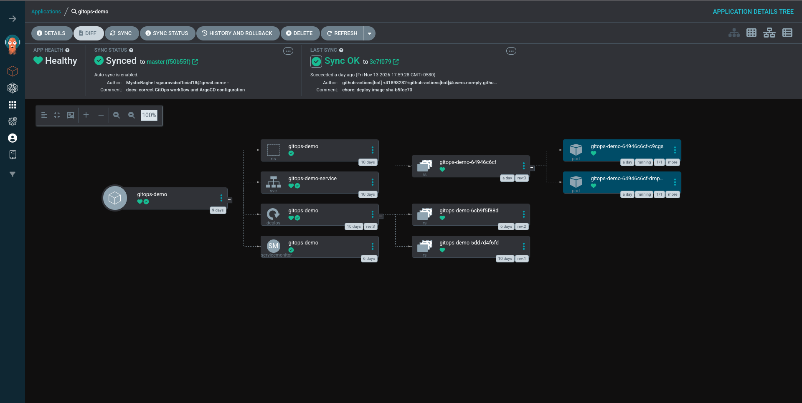
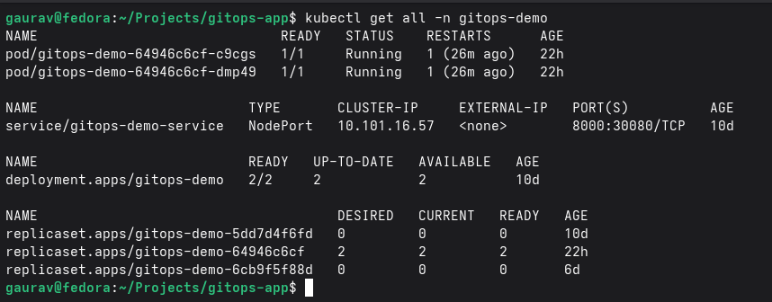
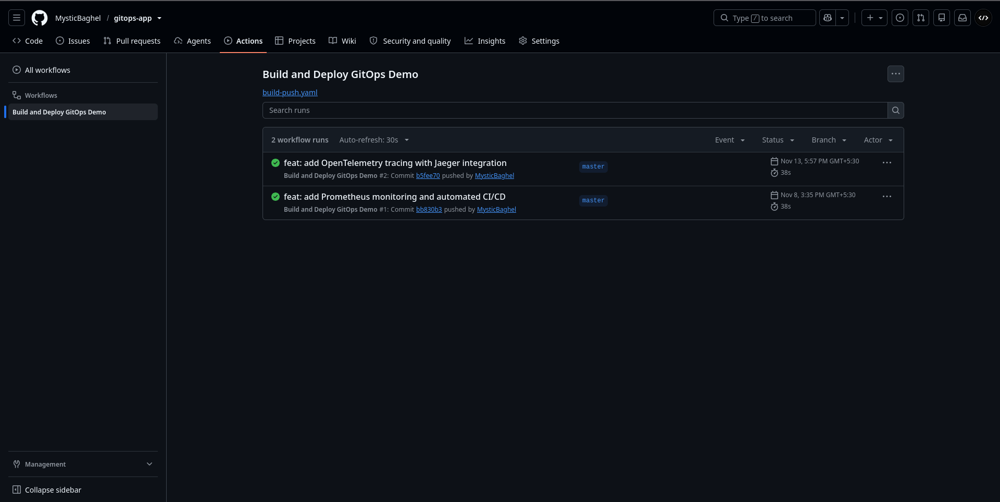
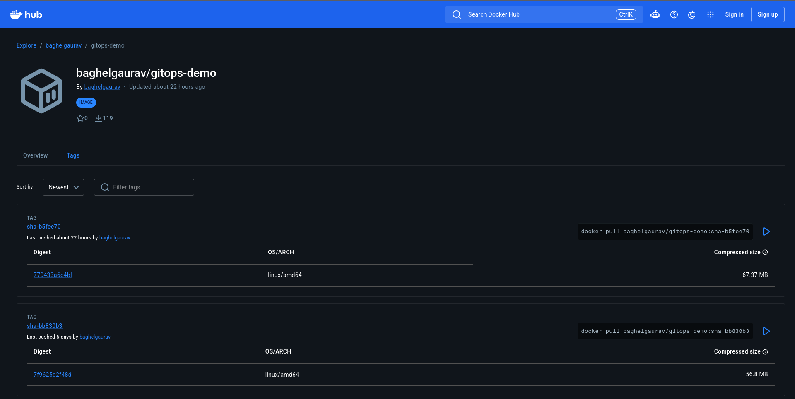
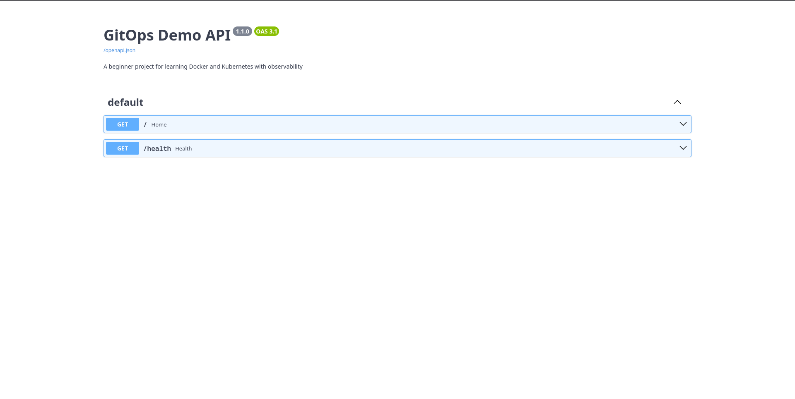

# Testing and Validation

Use this guide to verify the local Kubernetes cluster, the FastAPI Deployment, and the Argo CD GitOps workflow. Run the commands from a terminal with the project tools installed and the correct Kubernetes context selected.

## 1. Validate the Kubernetes Cluster

Check that the Minikube node is ready:

```bash
kubectl get nodes
```

The node should report `Ready`.

Check the application resources:

```bash
kubectl get all -n gitops-demo
```

Check Argo CD pods and the Application:

```bash
kubectl get pods -n argocd
kubectl get application gitops-demo -n argocd
```

The Application should report `Synced` and `Healthy` when the repository revision has been applied and the managed resources are healthy.

## 2. Validate the FastAPI Application

Check the Deployment and Pods:

```bash
kubectl get deployment gitops-demo -n gitops-demo
kubectl get pods -n gitops-demo -o wide
```

Forward the Service port to the local machine:

```bash
kubectl port-forward -n gitops-demo service/gitops-demo-service 8000:8000
```

Keep that terminal running. In another terminal, test the endpoints:

```bash
curl http://localhost:8000/
curl http://localhost:8000/health
curl http://localhost:8000/metrics
```

Stop the port-forward with `Ctrl+C` when the checks are complete.

## 3. Test Git-Driven Scaling (2 to 3 Replicas)

The starting Deployment configuration in Git is:

```yaml
spec:
  replicas: 2
```

Edit `k8s/deployment.yaml` and change the value to `3`. Commit and push the manifest change:

```bash
git add k8s/deployment.yaml
git commit -m "feat: scale FastAPI deployment to 3 replicas"
git push origin master
```

Watch the rollout:

```bash
kubectl get deployment gitops-demo -n gitops-demo -w
```

After Argo CD synchronizes the new revision, the expected Deployment summary is:

```text
READY   UP-TO-DATE   AVAILABLE
3/3     3            3
```

You can also check the Application status:

```bash
kubectl get application gitops-demo -n argocd
```

After recording the successful scaling demonstration, restore `replicas: 2` in `k8s/deployment.yaml`, commit, and push. Wait until the Deployment returns to two available replicas before continuing to the self-healing test.

## 4. Test Self-Healing

First confirm that Git specifies `replicas: 2` and the live Deployment has two replicas. Then manually change the live resource:

```bash
kubectl scale deployment gitops-demo \
  --replicas=4 \
  -n gitops-demo
```

Because `selfHeal: true` is enabled, Argo CD should detect that the live replica count differs from Git and reconcile it back to the Git-defined value of two.

Watch the Deployment:

```bash
kubectl get deployment gitops-demo -n gitops-demo -w
```

The replica count should return to `2/2` after reconciliation. This test demonstrates correction of manual drift; do not change the Git manifest during this test.

## 5. Pruning Behaviour

Pruning is enabled in the Argo CD Application. When a manifest managed by this Application is removed from the configured `k8s/` path in Git and the change is synchronized, Argo CD can delete the corresponding Kubernetes resource.

This is a destructive test. Do not delete the Namespace or Deployment manifests in a running environment just to capture a screenshot. If you demonstrate pruning, use a disposable test resource, verify that it is managed by this Application, and restore the manifest afterward.

## 6. Verify the CI/CD Image Update

Push a change to one of the paths configured in `.github/workflows/build-push.yaml`, such as `main.py` or `requirements.txt`:

1. Open the repository's **Actions** tab on GitHub.
2. Confirm that the **Build and Deploy GitOps Demo** workflow completes successfully.
3. Confirm that the new image tag is pushed to Docker Hub.
4. Confirm that GitHub Actions commits the updated image tag to `k8s/deployment.yaml`.
5. Confirm that Argo CD synchronizes the updated manifest.

The workflow uses image tags in the format `sha-<7-character-commit-sha>`. The workflow requires the `DOCKERHUB_USERNAME` and `DOCKERHUB_TOKEN` repository Actions secrets.

## 7. Captured Evidence

The `screenshots/` directory holds the evidence captured from the validated environment. Each image corresponds to a completed check:

| Screenshot | Verifies |
|---|---|
| [Argo CD Application](../screenshots/01-argocd-dashboard.png) | Application reports `Synced` and `Healthy` with all managed resources present. |
| [Kubernetes resources](../screenshots/02-kubernetes-resources.png) | Two running Pods, the NodePort Service, and a Deployment with two available replicas. |
| [GitHub Actions](../screenshots/03-github-actions.png) | The **Build and Deploy GitOps Demo** workflow completes successfully. |
| [Docker Hub](../screenshots/04-dockerhub.png) | Image tags such as `sha-b5fee70` are published to Docker Hub. |
| [Running application](../screenshots/05-running-application.png) | The deployed FastAPI application serves the `/` and `/health` endpoints. |

### Argo CD Application



### Kubernetes Resources



### GitHub Actions Pipeline



### Docker Hub Images



### Running Application



Do not mark a test as completed until its result has been observed in the cluster or the relevant GitHub/Argo CD interface.
